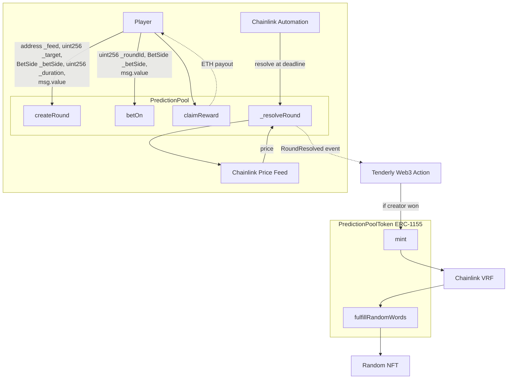

[](https://bet2gether-alpha.vercel.app)


[](LICENSE)

# Bet2Gether — A Web3 Prediction Markets Case Study

Bet2Gether is a learning project on Ethereum Sepolia (October–November 2025): binary prediction rounds settled by Chainlink services. Players bet ETH on whether a **Chainlink price feed** will close above or below a target by a deadline. **Chainlink Automation** triggers settlement, payouts are time-weighted (earlier bets carry more weight), and a round creator who wins can receive an **ERC-1155** collectible whose `tokenId` is picked by **Chainlink VRF**; a **Tenderly Web3 Action**, signing with my own key, requests that mint.

The payout has a known bug that leaves part of every pool locked in the contract: read [Known bugs](#known-bugs) before relying on the numbers below.

**[Live demo](https://bet2gether-alpha.vercel.app)**

---

## Try the Live Demo

To explore the live demo, you need a browser wallet ([MetaMask](https://metamask.io/) works) funded with Ethereum Sepolia ETH — grab some free from the faucet below. No local setup required.

1. Open the **[live demo](https://bet2gether-alpha.vercel.app)**.
2. Connect a wallet on **Ethereum Sepolia**.
3. Create a round (pick a Chainlink feed, target price, side, duration), or bet on an active round.
4. After the deadline, Chainlink Automation resolves the round; winners pull their payout with **Claim Rewards** (see [Known bugs](#known-bugs) for what that payout is).

Need testnet ETH? [Sepolia Faucet](https://sepolia-faucet.pk910.de/)


---

## Why

Prediction markets are interesting as a coordination problem only when settlement is credibly neutral. Two common designs sit in tension with that goal:

- **Operator-settled markets.** An admin or off-chain keeper picks the price, calls `resolve()`, and decides who gets paid. The value proposition of trust-minimized outcomes then rests on trusting that one entity.
- **Permissionless on-chain markets without a keeper.** Somebody still has to trigger resolution. If users do it, settlement is gameable (winners delay, losers grief). If a single bot does it, the trust assumption shifts back to that operator.

Reward distribution can introduce a second trust hole: random rewards driven by `block.hash`, `block.timestamp`, or admin-picked `tokenId`s are predictable or manipulable, especially by miners/validators or the operator themselves.

Bet2Gether is an experiment in that direction. Resolution is triggered by Chainlink Automation and priced by a Chainlink feed, and the collectible's `tokenId` comes from Chainlink VRF. Two pieces still depend on me: as the owner I can disable a price feed, and the reward mint is requested by a Tenderly action holding my minter key (see [Known bugs](#known-bugs)).

---

## Solution

Once a round opens, its outcome depends on the price feed and the deadline; the collectible's `tokenId` depends on the VRF response. Rounds go from **Active** to **Resolved**.

- **Deterministic resolution.** [`PredictionPool._resolveRound`](be/src/PredictionPool.sol) reads `AggregatorV3Interface.latestRoundData()` for the round's allow-listed feed and compares it to `round.target`. Decimals are normalized to 1e18 and non-positive answers revert. The price is the one current when Automation runs, not at the deadline, and its age (`updatedAt`) is not checked.
- **Autonomous execution.** [`PredictionPool`](be/src/PredictionPool.sol) implements `AutomationCompatibleInterface`. `checkUpkeep` returns the IDs of rounds whose deadline has passed; `performUpkeep` re-checks each ID, resolves the due rounds in one batch and emits `PredictionPool_RoundResolved`. No user has to call `resolve()`.
- **Time-weighted bets.** [`getBetWeight`](be/src/PredictionPool.sol) scales each bet by `((round.end - bet.time) * 1e18) / (round.end - round.start)`, so an earlier bet weighs more than a late one. A winner's payout is `pool × playerWeight / getTotalWeight()`, where the total includes the losing side's weight too, so winners together do not receive the whole pool (see [Known bugs](#known-bugs)).
- **Pull payments with CEI + reentrancy guard.** `claimReward` marks `bet.claimed = true` and emits before the external ETH transfer, and is protected by OpenZeppelin's `nonReentrant`.
- **VRF-picked collectible.** [`PredictionPoolToken`](be/src/PredictionPoolToken.sol) is an ERC-1155 minted only via `VRFConsumerBaseV2Plus`. The `tokenId = randomWord % I_MAX_TOKEN_ID` is computed inside `fulfillRandomWords`, so which collectible a winner gets cannot be predicted from on-chain state. Requests are stored, and unknown or already fulfilled requests are refused.
- **Off-chain reward bridge.** `PredictionPool` never calls the token. A Tenderly Web3 Action ([`web3-actions/actions/predictionPoolActions.ts`](web3-actions/actions/predictionPoolActions.ts)) listens for `PredictionPool_RoundResolved` and, when `creatorIsWinner == true`, calls `PredictionPoolToken.mint(creator)` with a key that holds `MINTER_ROLE`. It reads only the first `RoundResolved` event of a transaction and logs a failure without retrying.

---

## Features in Action

### Create a round and bet

The round creator picks a Chainlink feed, target price, side, and duration. Their bet is the first one in.


A second player joins on the opposite side. Time-weighted bookkeeping is updated on each bet.


### Autonomous resolution by Chainlink Automation

When the deadline hits, `checkUpkeep` flags the round and Chainlink Automation calls `performUpkeep`. The contract reads the price feed, picks the winning side, and emits `PredictionPool_RoundResolved`.


### Reward bridge: Tenderly + Chainlink VRF

If the round creator was on the winning side, the Tenderly Web3 Action requests an ERC-1155 mint for them. VRF picks the `tokenId`.


Tenderly execution log confirming the off-chain bridge fired:


### Pull-payment claim

Winners claim from the Claim Rewards tab. Payouts are `pool × playerWeight / totalWeight`, where `totalWeight` sums both sides (see [Known bugs](#known-bugs)).


---

## Architecture

Two contracts on Sepolia, an off-chain Tenderly Action that turns resolution events into a mint call, and a Next.js client wired up through wagmi/viem.

#### System overview: resolution by Automation and the off-chain reward bridge

Rounds move from **Active** toward **Resolved** via Automation. `_resolveRound` reads the feed for settlement.

A **Tenderly Web3 Action** listens for `PredictionPool_RoundResolved`. When the configured logic applies (e.g. round creator is a winner), it calls `PredictionPoolToken.mint(to)`. VRF fulfillment performs `_mint`.



#### Key patterns

| Pattern | Rationale |
|---------|-----------|
| **Checks-Effects-Interactions (CEI)** | In `claimReward`, internal state (e.g. `claimed`) is updated before the external ETH transfer ([`PredictionPool`](be/src/PredictionPool.sol)). |
| **Reentrancy guard** | `nonReentrant` on `claimReward` only ([`PredictionPool`](be/src/PredictionPool.sol)). |
| **Defensive upkeep** | `performUpkeep` re-checks that each round is due, so bogus `performData` cannot resolve a round early or twice. |
| **Non-deterministic rewards** | Chainlink VRF v2.5 delivers a verifiable random word via callback; `tokenId = _randomWords[0] % I_MAX_TOKEN_ID` maps it into the valid ERC-1155 range, so the collectible's identity is unpredictable until the response arrives on-chain ([`PredictionPoolToken`](be/src/PredictionPoolToken.sol)). |

---

## Tech Stack

| Layer | Technologies |
|-------|--------------|
| Smart contracts | Solidity ^0.8.13, Foundry (build, test, script), OpenZeppelin (Ownable, AccessControl, ReentrancyGuard, ERC1155) |
| Oracle middleware | Chainlink Automation, Chainlink Price Feeds, Chainlink VRF v2.5 |
| Off-chain orchestration | Tenderly Web3 Actions, Alchemy RPC + WebSockets |
| Frontend | Next.js 16 (App Router), React 19, TypeScript, Tailwind CSS 4, Radix UI, shadcn/ui |
| Web3 client | wagmi v2, viem, RainbowKit |
| State and tables | TanStack Query v5, TanStack Table, React Context (rounds/bets) |
| Forms | React Hook Form + Zod |
| Quality | Foundry tests + coverage, ESLint, GitHub Actions CI ([`.github/workflows/foundry-tests.yml`](.github/workflows/foundry-tests.yml)) |

---

## Test Metrics

65 Foundry tests: 46 on `PredictionPool` (including time-weight edge cases such as a last-second bet in a 365-day round) and 19 on `PredictionPoolToken`. CI runs `forge test -vvv` on every push and PR to `main`/`develop` ([`.github/workflows/foundry-tests.yml`](.github/workflows/foundry-tests.yml)). No test claims a payout with bets on both sides, which is how the payout bug went unnoticed.

Coverage from the committed [`be/lcov.info`](be/lcov.info). Branch coverage shows how much of the conditional branching ran under tests, not how complete the tests are.

| Contract | Lines | Branches | Functions |
|----------|-------|----------|-----------|
| PredictionPool | 88.9% | 77.8% | 95.0% |
| PredictionPoolToken | 85.7% | 25.0% | 87.5% |

```bash
cd be && forge install
cd be && forge test --gas-report
cd be && forge coverage
```

---

## Setup (Deployment and Verification)

### Deployed addresses (Sepolia)

| Contract | Address |
|----------|---------|
| PredictionPool | `0x51A0a7561dEbA056C1cDF5aB4c369Db686c77EF6` |
| PredictionPoolToken | `0xddd3c73caE8541FC6Ea119C1BffC5B6547D33eCf` |

Etherscan: [PredictionPool](https://sepolia.etherscan.io/address/0x51A0a7561dEbA056C1cDF5aB4c369Db686c77EF6) · [PredictionPoolToken](https://sepolia.etherscan.io/address/0xddd3c73caE8541FC6Ea119C1BffC5B6547D33eCf).

### Contracts

Set `ALCHEMY_SEPOLIA_RPC_URL`, `PRIVATE_KEY`, and `ETHERSCAN_API_KEY` in `be/.env`. Allow-listed feeds and VRF parameters live in [`be/script/Constants_PredictionPool.sol`](be/script/Constants_PredictionPool.sol) and [`be/script/Constants_PredictionPoolToken.sol`](be/script/Constants_PredictionPoolToken.sol).

```bash
cd be
forge script script/PredictionPoolScript.s.sol \
  --rpc-url $ALCHEMY_SEPOLIA_RPC_URL --broadcast --verify
forge script script/PredictionPoolTokenScript.s.sol \
  --rpc-url $ALCHEMY_SEPOLIA_RPC_URL --broadcast --verify
```

After deployment, fund the Chainlink Automation upkeep registered for `PredictionPool` and the VRF subscription configured for `PredictionPoolToken`.

### Frontend

```bash
cd fe && pnpm install && pnpm dev
```

`fe/.env` requires `NEXT_PUBLIC_ETH_SEPOLIA_ALCHEMY_HTTP_URL`, `NEXT_PUBLIC_ETH_SEPOLIA_ALCHEMY_WS_URL`, and `NEXT_PUBLIC_WALLETCONNECT_PROJECT_ID`. Network config: [`fe/app/_config/wagmi.ts`](fe/app/_config/wagmi.ts).

After deploying the contracts, sync ABIs and addresses in [`fe/app/_contracts/`](fe/app/_contracts/).

### Tenderly Web3 Action

The action source is [`web3-actions/actions/predictionPoolActions.ts`](web3-actions/actions/predictionPoolActions.ts) and the trigger spec is [`web3-actions/tenderly.yaml`](web3-actions/tenderly.yaml). Configure the Tenderly project secrets `PRIVATE_KEY` (the address holding `MINTER_ROLE` on `PredictionPoolToken`) and `RPC_URL_KEY`, then deploy:

```bash
cd web3-actions && tenderly actions deploy
```

---

## Known bugs

- **Payout locks part of the pool.** `claimReward` computes `pool × playerWeight / getTotalWeight()`, and `getTotalWeight` sums the weights of **both** sides. Winners together receive only `pool × winnersWeight / allWeight`; the rest stays in the contract. Example: A bets 1 ETH above, B bets 1 ETH below at the same time, and "above" wins: A gets 1 ETH, and B's 1 ETH stays locked. A round with no winning bets locks the whole pool. There is no refund or sweep. Fix: divide by the winning side's weight, and add a refund path for one-sided rounds.
- **The owner can freeze resolution.** Disabling a price feed (`toggleAllowPriceFeed`) makes rounds on that feed revert when resolved; `performUpkeep` resolves due rounds in one batch, so one revert blocks every due round.
- **Unbounded loops.** `checkUpkeep` scans every round ever created and `claimReward` loops over every player, so gas grows with use until Automation or claims run out of gas.
- **The reward mint depends on an off-chain bot.** The Tenderly action (my key, with `MINTER_ROLE`) handles only the first `RoundResolved` event per transaction and logs failures without retrying.

## Known limitations

- **Price at resolution time.** The round settles on the feed's latest answer when Automation runs, which can be after the deadline, and the answer's age is not checked.
- **Rounding dust** from the weight math stays in the contract.
- **Unused states.** `NotStarted` and `Ended` exist in the round enum but are never kept: a round goes from Active to Resolved.

## Roadmap

- **L2 convergence.** Deploy to Arbitrum or Optimism (or similar) to compare settlement and UX cost vs Sepolia/L1-style usage.
- **Fix the payout.** Divide by the winning side's weight and refund one-sided rounds (see [Known bugs](#known-bugs)).
- **On-chain reward path.** Replace the Tenderly-triggered minting with a call from `PredictionPool`, so no off-chain key is needed.
- **Bounded loops.** Track due rounds and claim per player instead of scanning every round and player.

---

## Author

Built solo by **Siegfried Bozza**, Full-Stack Web3 Engineer (Foundry · Solidity · Chainlink · React · Next.js), October–November 2025.

[LinkedIn](https://www.linkedin.com/in/siegfriedbozza/) 
